# ha-cloud-card

[](https://www.home-assistant.io/integrations/marketplace/)
[](https://github.com/juju35/ha-cloud-card/actions/workflows/hacs.yml)
[](https://github.com/juju35/ha-cloud-card/actions/workflows/validate.yml)
[](https://github.com/juju35/ha-cloud-card/actions/workflows/lint.yml)
[](https://github.com/juju35/ha-cloud-card/releases/latest)
[](https://github.com/juju35/ha-cloud-card/blob/main/LICENSE)
[](https://buymeacoffee.com/julienstep9)

<p align="center"></p>

**Home Assistant Cloud** (Nabu Casa) and remote access at a glance, under an animated illustration: a house linked to the cloud, linked to a phone, with the data flowing along the links. When the cloud connection drops, the check turns into a red cross and the flow stops.

The cards read the [Home Assistant Cloud integration](https://www.home-assistant.io/integrations/cloud/) directly: nothing to configure, add the card and it shows the cloud connection, the remote access and its certificate, the subscription, cloud backups, Alexa, Google Assistant, webhooks and cloud text-to-speech.

[](https://my.home-assistant.io/redirect/marketplace_repository/?owner=juju35&repository=ha-cloud-card&category=plugin)

| Connected | Disconnected |
|---|---|
| <picture><source media="(prefers-color-scheme: dark)" srcset="https://raw.githubusercontent.com/juju35/ha-cloud-card/main/screenshots/card-dark.png">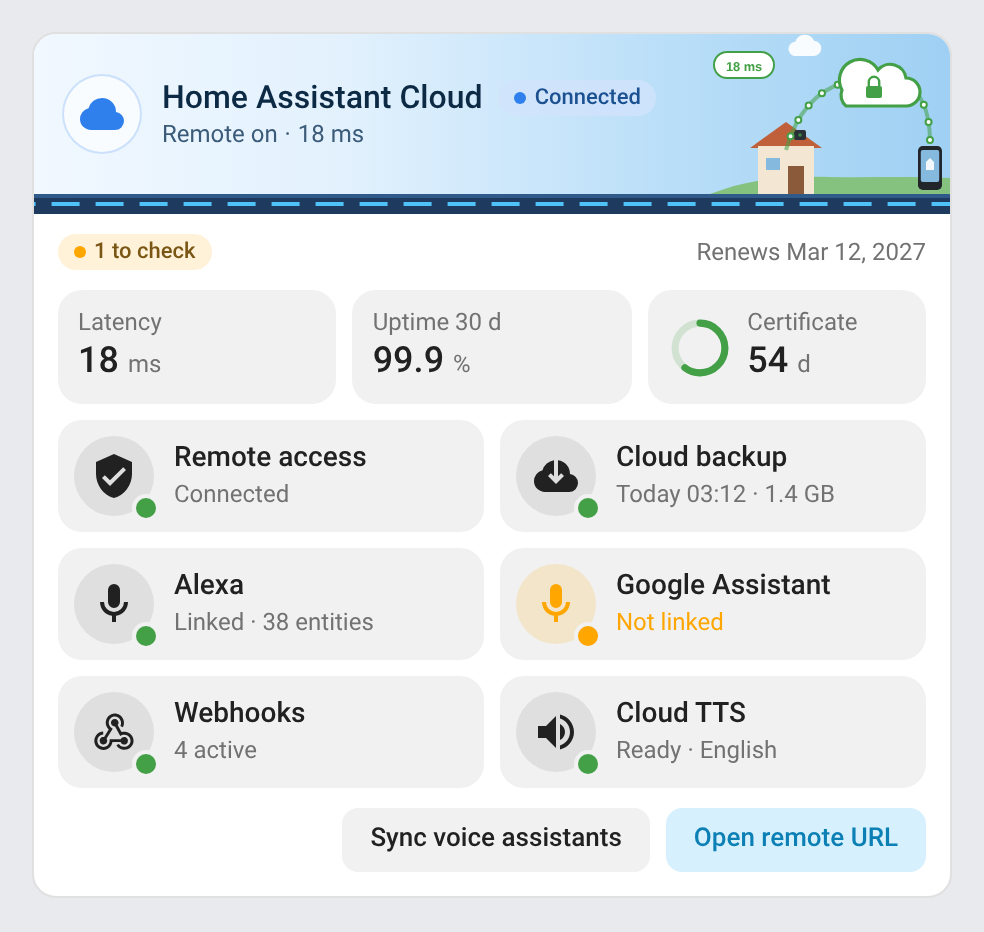</picture> | <picture><source media="(prefers-color-scheme: dark)" srcset="https://raw.githubusercontent.com/juju35/ha-cloud-card/main/screenshots/card-disconnected-dark.png">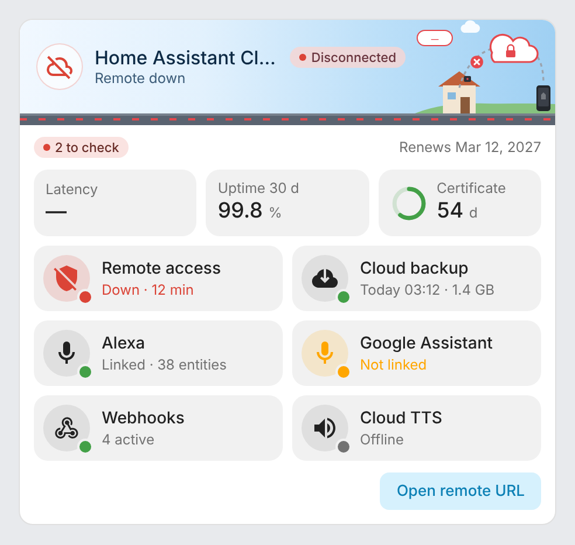</picture> |
| <picture><source media="(prefers-color-scheme: dark)" srcset="https://raw.githubusercontent.com/juju35/ha-cloud-card/main/screenshots/mini-card-dark.png">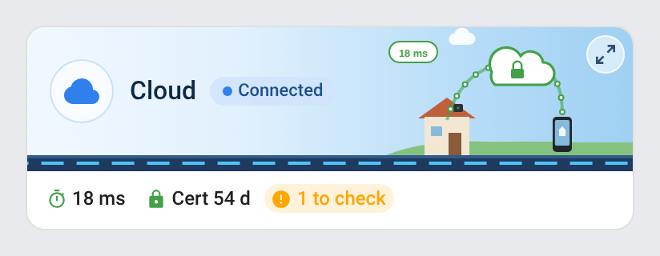</picture> | <picture><source media="(prefers-color-scheme: dark)" srcset="https://raw.githubusercontent.com/juju35/ha-cloud-card/main/screenshots/mini-card-disconnected-dark.png">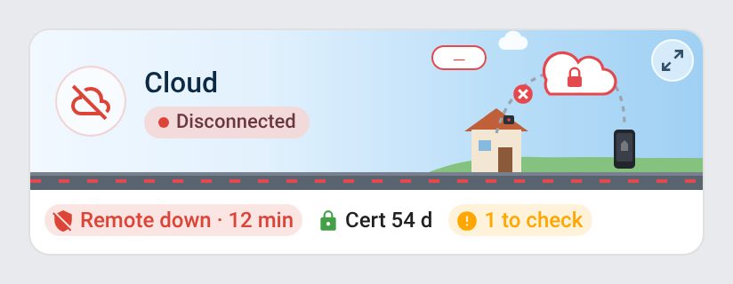</picture> |

## Features

- Two cards: a full **Cloud Card** and a compact **Cloud Mini Card**, of type `custom:cloud-card` and `custom:cloud-mini-card`
- The illustration is the 90 px header: sky, a house linked to the cloud (its padlock in the state colour) and to a phone away by an encrypted tunnel, a latency pill above, and a 10 px network strip at the bottom. Connected, green dots flow along the tunnel and packets run along the strip; connecting, everything turns amber and slows down; disconnected, the tunnel breaks with a red cross, the phone goes dark and the strip turns grey with red dashes. The round header icon always takes the state colour (blue connected, amber connecting, red disconnected, grey signed out)
- **Night mode** of the illustration: midnight-blue sky, stars and moon, lit windows; it shows when the sun (`sun.sun`) is below the horizon or the theme of Home Assistant is dark, or is forced with `illustration_theme`
- Status chips: the cloud connection (**Connected**, **Connecting**, **Disconnected**, **Subscription expired**), the number of services to check, and the subscription's renewal date on the right
- Three indicators: the **latency** of the remote access, the **availability** of the remote access over 30 days, and the **days left on the remote certificate** with a ring (amber under 14 days, red under 3)
- Six service tiles, the size of Home Assistant's Tile card, neutral while healthy and coloured only when something needs a look: **Remote access**, **Cloud backup** (last backup stored in the cloud, its size), **Alexa** and **Google Assistant** (linked, exposed entities), **Webhooks** (cloudhooks), **Cloud TTS** (default voice)
- Tap a tile for its details in a popup at the top of the card (remote URL, certificate, last and next backups, report state, exposed entities, voice…); it closes with its button, a click anywhere else, Escape, or when the card leaves the page
- Tinted buttons (never filled): **Sync voice assistants** (Alexa and Google Assistant) and **Open remote URL**; `hide_url` masks the remote URL shown in the card
- Mini card: the same 90 px banner with the cloud badge (`mdi:cloud-off-outline` in red when disconnected), the status and a detail button that unfolds the full card, then chips for the latency, the certificate and what needs a look (« Remote down · 12 min », « 1 to check »); a click anywhere outside the card folds it back. `illustration: false` gives the compact header without the banner
- Works for every user: administrators get everything, other users what Home Assistant lets them read (see [Users who are not administrators](#users-who-are-not-administrators))
- Visual editor for both cards; options left at their default are kept out of the YAML
- Light and dark themes, `prefers-reduced-motion` honoured
- English, French, German, Spanish, Serbian (Cyrillic and Latin), Italian, Dutch, European Portuguese, Polish, Romanian, Danish, Swedish, Bulgarian, Russian, Ukrainian, Hungarian, Slovak, Czech, Slovenian, Latvian and Greek
- Single file, no external dependency: the illustration and the icons (Material Design Icons) are drawn in SVG

## Supported integrations

| Integration | What the cards show |
|---|---|
| [Home Assistant Cloud](https://www.home-assistant.io/integrations/cloud/) (built in) | The cloud status (connection, remote access, remote domain and certificate, Alexa and Google Assistant preferences, cloudhooks, default voice), the subscription, the history of its **Remote UI** binary sensor, and the cloud backups of the [Backup](https://www.home-assistant.io/integrations/backup/) integration |

## Prerequisites

- Home Assistant 2025.2 or later
- Home Assistant Cloud set up and signed in (**Settings → Home Assistant Cloud**); the card says so when it is not
- The [recorder](https://www.home-assistant.io/integrations/recorder/) (on by default) for the availability indicator

## Installation

### Via the Marketplace (recommended)

Click the button below to add the repository directly:

[](https://my.home-assistant.io/redirect/marketplace_repository/?owner=juju35&repository=ha-cloud-card&category=plugin)

Then click **Install**, and reload your browser when the Marketplace asks you to.

Or manually:

1. Open **Settings → Marketplace → Add from link** (top right; this needs a GitHub account connected)
2. Add `https://github.com/juju35/ha-cloud-card` — Category: **Dashboard** (Lovelace)
3. Open **Cloud Card** and click **Install**
4. Clear your browser cache and refresh

The Marketplace registers the dashboard resource for you (`/local/community/ha-cloud-card/cloud-card.js`); the single file provides both cards.

### Manual

1. Download `cloud-card.js` and the `cloud-card.i18n.*.js` translation files from the [latest release](https://github.com/juju35/ha-cloud-card/releases/latest)
2. Copy them all to `/config/www/` (without the translation files, the cards show in English)
3. Go to **Settings → Dashboards → ⋮ → Resources** → Add resource:
   - URL: `/local/cloud-card.js`
   - Type: **JavaScript Module**
4. Clear your browser cache and refresh

## Configuration

### Visual editor

Edit a dashboard, click **Add card** and search for **Cloud Card** or **Cloud Mini Card**. Everything is found by itself; set the title, the banner and its theme, the uptime period, the parts to show, the latency measure, the URL mask and the language. The preview updates live, and options left at their default are kept out of the generated YAML. The mini card's editor also has the full card's options, used by its unfolded view.

### Minimal

```yaml
type: custom:cloud-card
```

```yaml
type: custom:cloud-mini-card
```

### Full options

```yaml
type: custom:cloud-card
title: Remote access
remote_entity: binary_sensor.remote_ui
illustration: true
illustration_theme: auto
uptime_days: 30
show_indicators: true
show_services: true
show_buttons: true
latency: true
hide_url: false
services:
  - remote
  - backup
  - alexa
  - google
  - webhooks
  - tts
language: en
```

```yaml
type: custom:cloud-mini-card
illustration_theme: night
hide_url: true
zoom: true
```

### Options reference

| Option | Card | Default | Description |
|---|---|---|---|
| `title` | both | « Home Assistant Cloud » (mini: « Cloud ») | Card title |
| `remote_entity` | both | Discovered | The cloud integration's **Remote UI** binary sensor, used for the availability and the « down for » durations. Found in the entity registry (platform `cloud`, whatever its name), else `binary_sensor.remote_ui` |
| `illustration` | both | `true` | The animated illustration as header; `false` for a classic header with a round icon |
| `illustration_theme` | both | `auto` | `auto` (night when `sun.sun` is below the horizon or the theme of Home Assistant is dark), `day` or `night` |
| `uptime_days` | both | `30` | Period of the availability indicator, 1 to 30 days (shorter when the recorder keeps less history) |
| `show_indicators` | both | `true` | The latency, availability and certificate indicators |
| `show_services` | both | `true` | The service tiles |
| `show_buttons` | both | `true` | The **Sync voice assistants** and **Open remote URL** buttons |
| `latency` | both | `true` | Measure the latency from the browser through the remote URL (see [Latency](#latency)); `false` sends no request and shows « — » |
| `hide_url` | both | `false` | Mask the instance part of the remote URL in the card (`https://••••••••••••.ui.nabu.casa`) |
| `services` | both | All six | **YAML only.** The service tiles and their order: `remote`, `backup`, `alexa`, `google`, `webhooks`, `tts` |
| `zoom` | mini | `true` | Detail button (beside the title on the banner, at the top right without it): unfolds the full card and back (`false` removes it). The full card's options above apply to the unfolded view and are also set in the mini card's visual editor |
| `language` | both | Auto | Force language: `en`, `fr`, `de`, `es`, `sr`, `sr-Latn`, `it`, `nl`, `pt`, `pl`, `ro`, `da`, `sv`, `bg`, `ru`, `uk`, `hu`, `sk`, `cs`, `sl`, `lv` or `el` (auto-detects from HA settings) |

Every option but `services` (a list) is in the visual editor.

## Screenshots

### Animations

While the cloud is connected, dots flow from the house to the cloud and on to the phone, the router light blinks, a cloud drifts and packets run along the strip, in a loop of 8 seconds; connecting, the flow runs at half speed. When the cloud connection drops, the tunnel breaks with a red cross and the flow and the packets stop; only the cloud still drifts. At night, the stars twinkle. With `prefers-reduced-motion`, everything stays still.

Connected:

| Light | Dark |
|---|---|
| 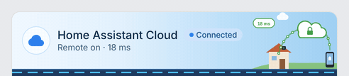 | 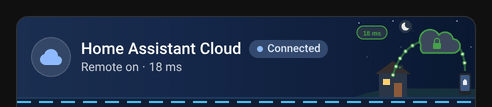 |

Disconnected:

| Light | Dark |
|---|---|
| 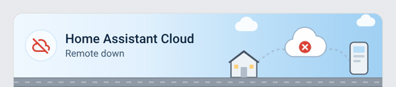 | 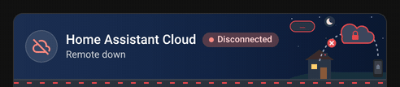 |

Night:

| Light | Dark |
|---|---|
| 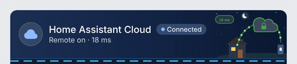 |  |

### Cloud Card

| Light | Dark |
|---|---|
|  | 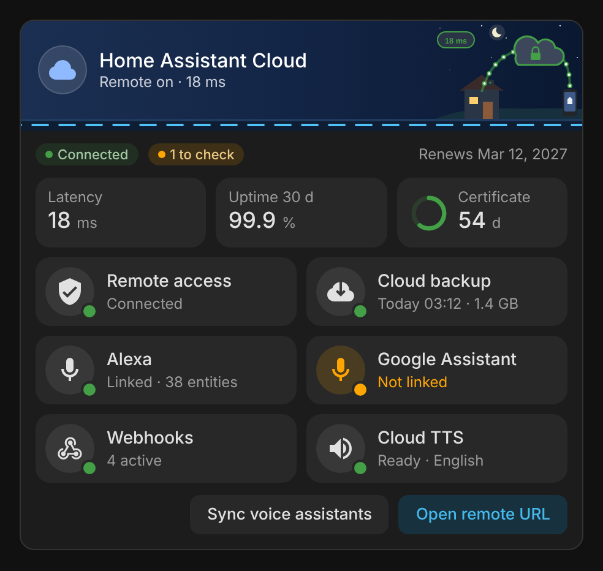 |
|  | 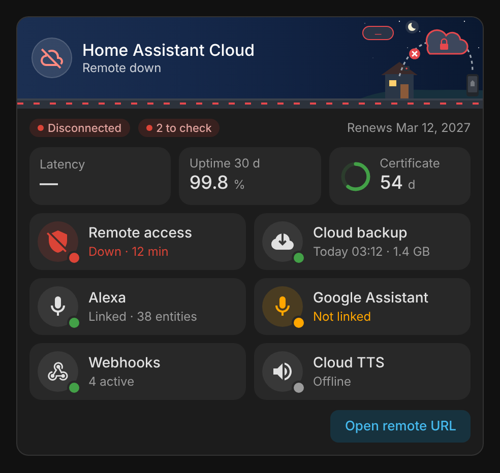 |

Night illustration (`illustration_theme: night`, or automatic after sunset or with a dark theme):

| Light | Dark |
|---|---|
| 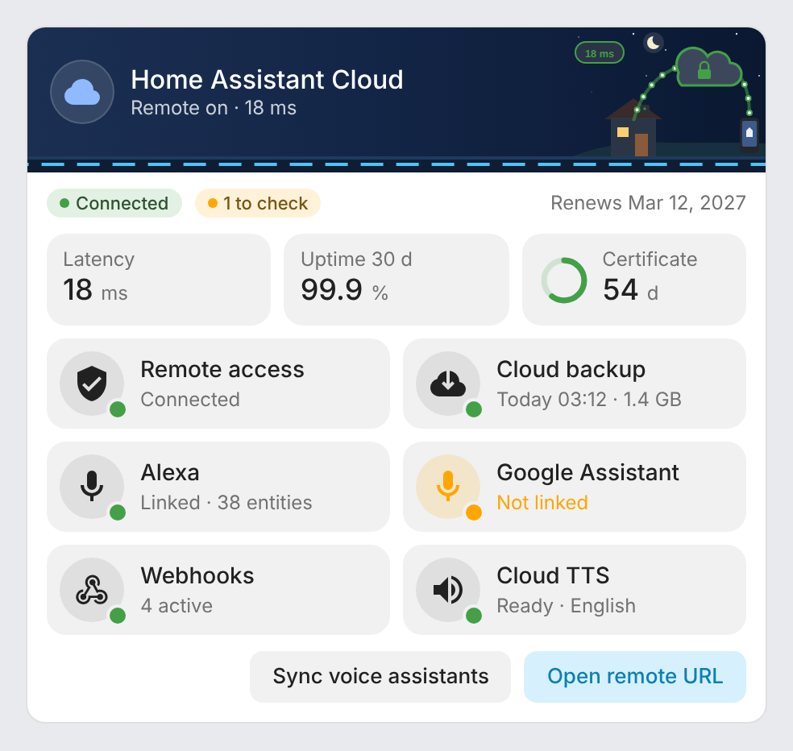 | 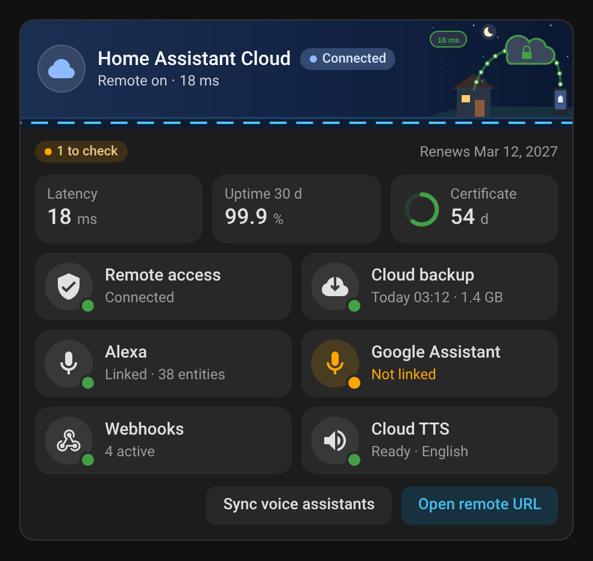 |

Details of a service, at the top of the card (here with `hide_url: true`):

| Light | Dark |
|---|---|
| 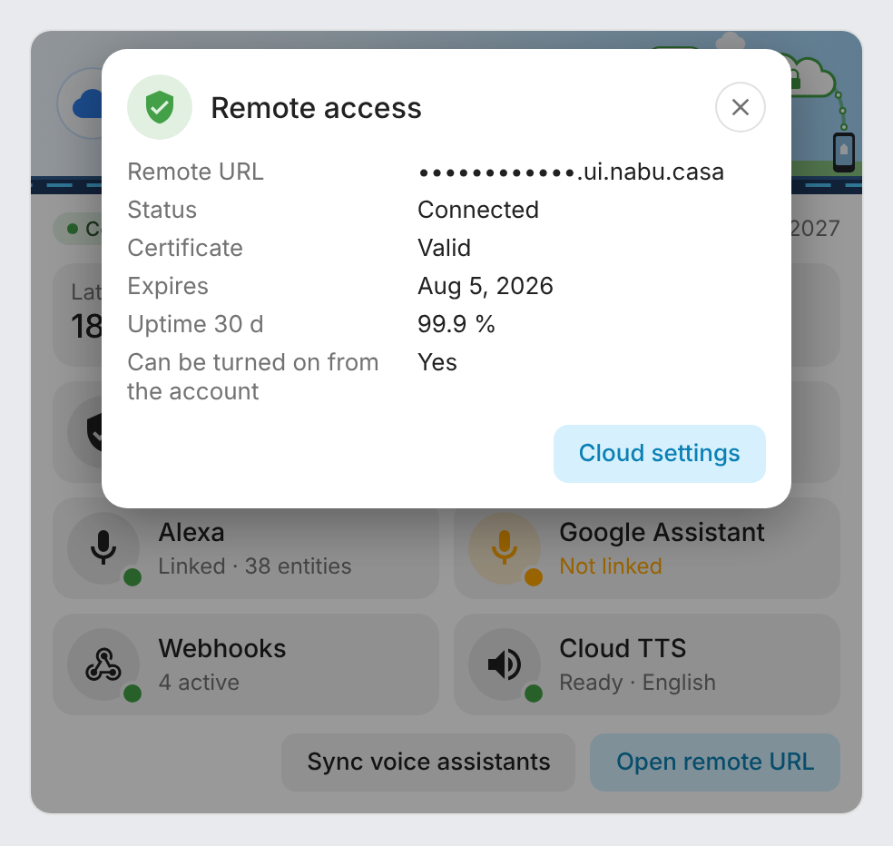 | 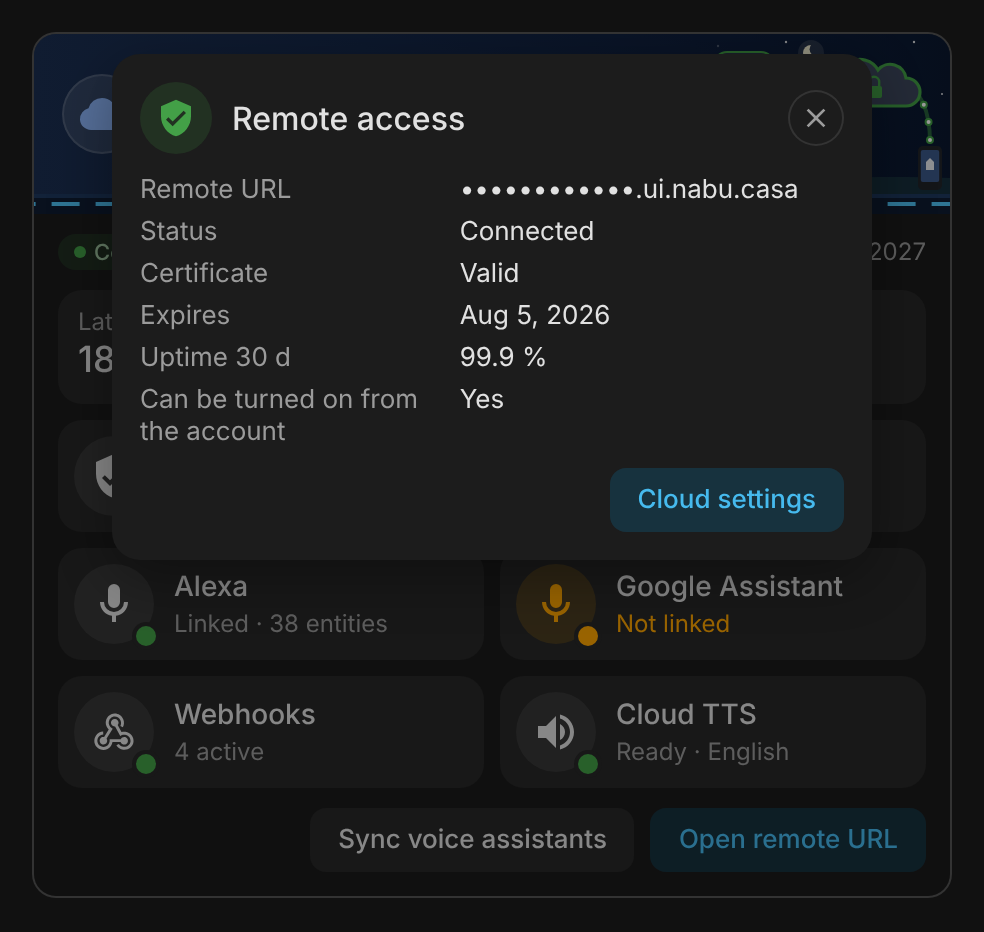 |

Classic header (`illustration: false`):

| Light | Dark |
|---|---|
| 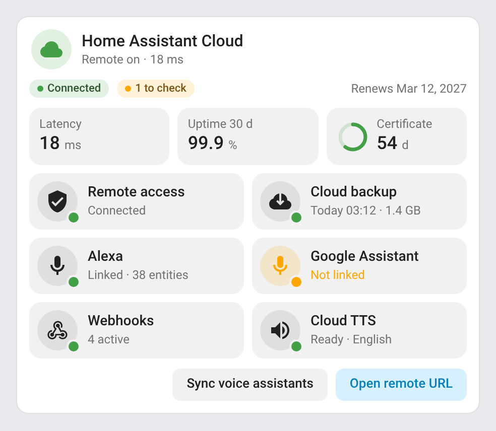 | 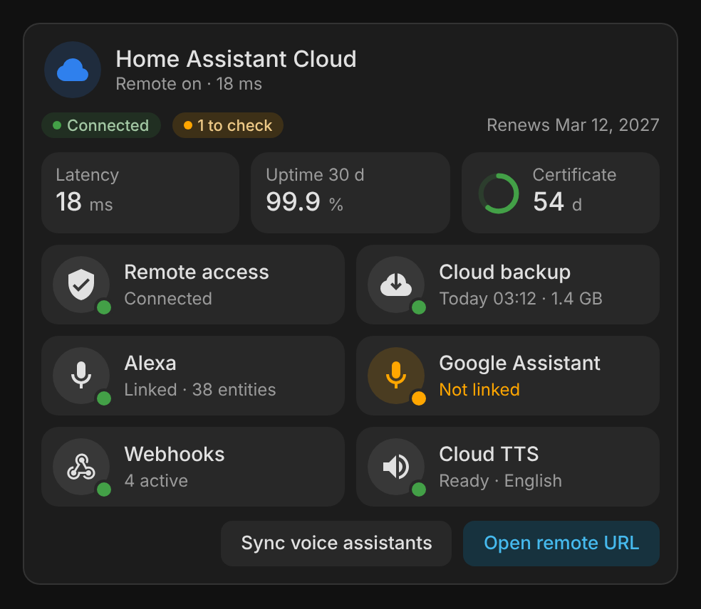 |

### Cloud Mini Card

| Light | Dark |
|---|---|
|  | 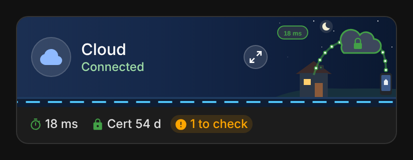 |
|  | 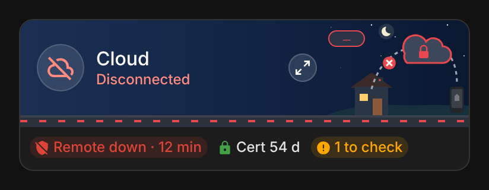 |

Unfolded with its detail button (top right; click it again or anywhere outside the card to go back):

| Light | Dark |
|---|---|
| 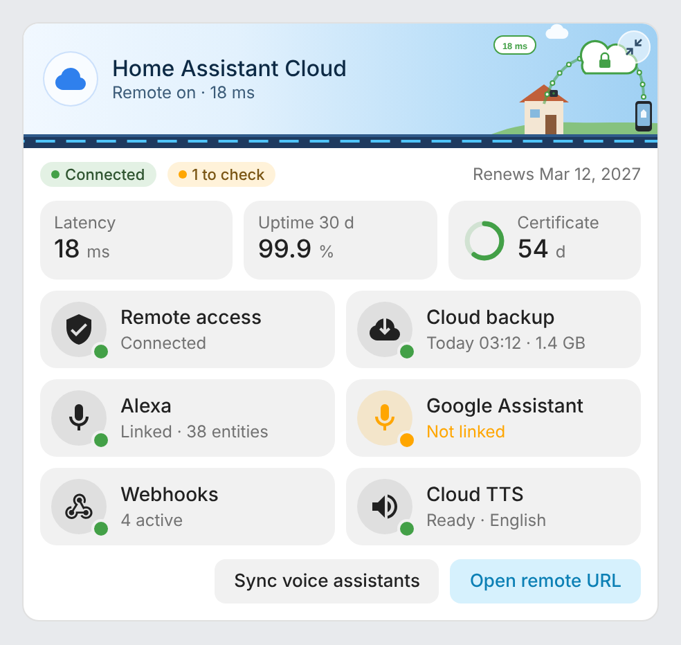 | 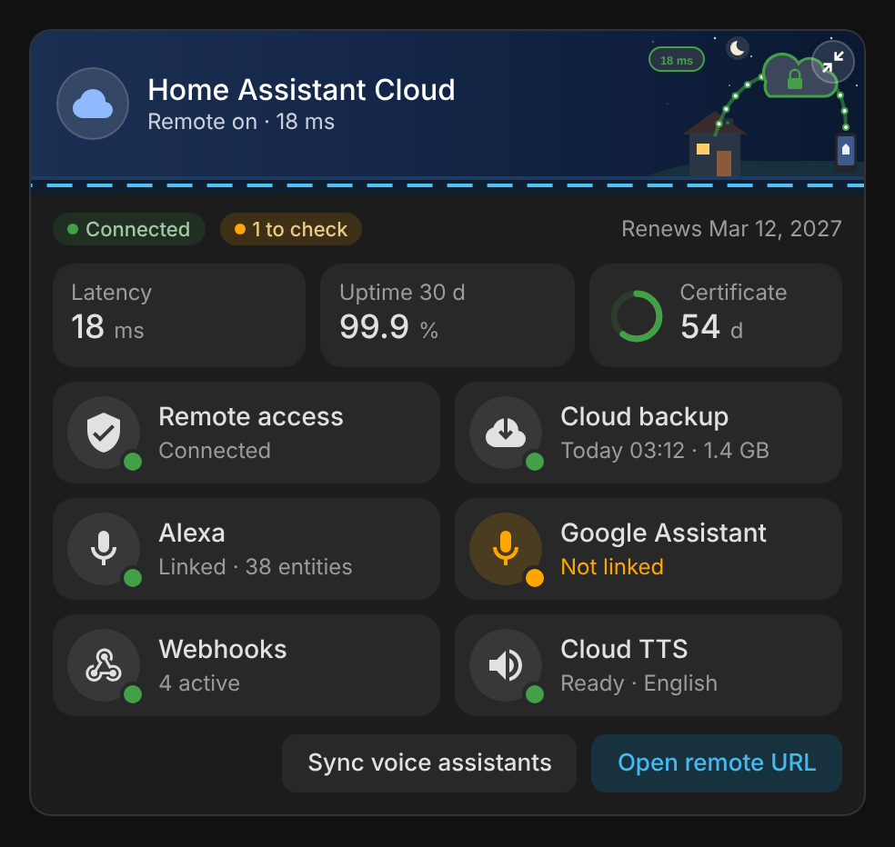 |

## How it works

### Data

The cards ask Home Assistant over its websocket connection, the way its own cloud settings do:

| Source | What it gives | Who |
|---|---|---|
| `cloud/status` | Signed in, the cloud connection (`connected`, `connecting`, `disconnected`), the remote access (`remote_enabled`, `remote_connected`, `remote_domain`, the certificate and its status), Alexa and Google Assistant (enabled, linked, report state), the cloudhooks, the default voice, an expired subscription | Every user |
| `cloud/subscription` | The renewal date | Administrators |
| `backup/info` | The backups stored on the cloud agent (`cloud.cloud`): last date, size, count, next automatic backup | Administrators |
| `homeassistant/expose_entity/list` | The entities exposed to Alexa and to Google Assistant | Administrators |
| `history/history_during_period` | The **Remote UI** binary sensor over the uptime period | Every user who can read it |

The status is read every minute, and at once when the Remote UI sensor changes; the backups and the exposed entities every 5 minutes, the history every 15 minutes, the subscription every 6 hours.

### Latency

Home Assistant does not expose any latency of the cloud or of the remote access. The card measures the closest real value: the round trip from **your browser to your Home Assistant through its remote URL** (the Nabu Casa relay), with a small request to its public `manifest.json` (no credentials, the best of two after one that opens the connection), once a minute while the remote access is connected and the page is visible. Turn it off with `latency: false`.

### Availability

The availability is the share of time the **Remote UI** sensor was connected over the period, from the recorder history; restarts (unavailable or unknown) are left out. When the recorder keeps less history than the period (10 days by default), the label shows the days actually covered.

### What needs a look

| Tile | Amber | Red |
|---|---|---|
| Remote access | Certificate being prepared | Down (with how long), certificate error |
| Cloud backup | Last cloud backup more than 3 days old | Upload to the cloud failed |
| Alexa | Report state on but the skill needs to be linked again | |
| Google Assistant | Enabled but not linked | |

A service turned off stays grey; the others stay neutral while healthy. The « to check » chip counts the amber and red tiles.

### Users who are not administrators

Home Assistant reserves the subscription, the backup list and the exposed entities to administrators. For other users, the card shows the cloud status and the availability, takes the last backup from the Backup integration's **Last successful automatic backup** sensors, leaves out the renewal date and the entity counts, and hides the **Sync voice assistants** button (an administrator action).

### Narrow cards

The full card fits down to 8 columns of a sections view (about 208 px on a phone), the mini card down to 6 columns (about 156 px). The scene is left out below about 300 px, the certificate ring below 380 px, and the tiles go to one column below 260 px. In a container sized by its content, the cards take a width of 400 px instead of collapsing.

## Development

```bash
npm install
npm run build        # bundles src/cloud-card.js into dist/cloud-card.js and stamps the version of package.json
npm run check        # builds and checks the bundle (run in CI)
npm test             # unit tests, and the browser layout tests (Chromium through Playwright)
npm run screenshots  # renders the cards with mock data (scripts/screenshots/mock.mjs) into screenshots/, and the animation GIFs (needs ffmpeg)
```

`dist/` is not committed: `npm run build` creates it locally, CI builds it on every push, and the release workflow attaches the built file to the release, which is where the Marketplace installs it from. The **Screenshots** workflow renders the captures again on every pull request that changes the sources and commits them to its branch.

### Releasing

1. Bump `version` in `package.json` (and `package-lock.json`)
2. Add a `## <version>` section at the top of [CHANGELOG.md](https://github.com/juju35/ha-cloud-card/blob/main/CHANGELOG.md)
3. Merge to `main`: the **Release** workflow builds the card, creates the tag and the GitHub release with the changelog section as notes, and attaches `cloud-card.js` and its translation files

## Translations

The cards auto-detect the language from your Home Assistant settings. Currently supported:

| Language | Code |
|---|---|
| English | `en` |
| Français | `fr` |
| Deutsch | `de` |
| Español | `es` |
| Српски (Serbian, Cyrillic) | `sr` |
| Srpski (Serbian, Latin) | `sr-Latn` |
| Italiano | `it` |
| Nederlands | `nl` |
| Português (Portugal) | `pt` |
| Polski | `pl` |
| Română | `ro` |
| Dansk | `da` |
| Svenska | `sv` |
| Български | `bg` |
| Русский | `ru` |
| Українська | `uk` |
| Magyar | `hu` |
| Slovenčina | `sk` |
| Čeština | `cs` |
| Slovenščina | `sl` |
| Latviešu | `lv` |
| Ελληνικά | `el` |

Contributions for additional languages are welcome!

## Contributing

Issues and pull requests are welcome: bug reports with your card configuration and a browser console extract, ideas, and translation fixes. Before opening a pull request, run `npm test` and `npm run check`; the screenshots are rendered by the CI on the pull request.

## Credits

Data from the [Home Assistant Cloud](https://www.home-assistant.io/integrations/cloud/) integration. Home Assistant Cloud is a service of Nabu Casa; this project is not affiliated with Nabu Casa. The account, remote URL and values of the screenshots are fictional.

## License

[MIT](https://github.com/juju35/ha-cloud-card/blob/main/LICENSE)

## Support

If you find this project useful, you can support its development:

<a href="https://buymeacoffee.com/julienstep9"></a>
